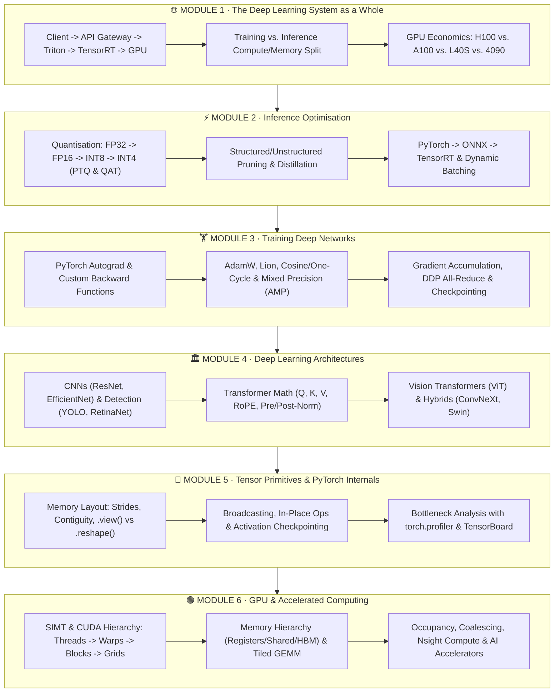

# ⚡ Deep Learning with Accelerated Computing
### `25CS3112E` · Complete Course Syllabus & Learning Roadmap

[-f59e0b?style=for-the-badge)](#)

  <em>Engineering deep-learning systems from top to bottom: bridging modern neural architectures, distributed multi-GPU training, and inference compilation all the way down to PyTorch tensor primitives and CUDA GPU kernels.</em>

---

[✨ What You Will Learn](#-what-you-will-learn) •
[🛠️ Tech Stack](#️-industry-tech-stack--tools) •
[🗺️ Curriculum Map](#️-curriculum-architecture-map) •
[📚 6 Core Modules](#-detailed-module-wise-syllabus) •
[🎓 Course Outcomes](#-course-outcomes-cos) •
[⚡ 12-Week Progression](#-12-week-accelerated-computing-progression) •
[🗓️ 24 Lectures](#️-24-session-classroom-lecture-plan) •
[📖 Resources](#-certifications--learning-resources)

---

## ✨ What You Will Learn

> *"Learning is empirical risk minimisation—a number you cannot reproduce is a rumour. And a speedup you did not profile is also a rumour."*

This course refuses to separate **deep-learning algorithms** from **accelerated hardware**. Instead of treating the GPU as a black box, you will learn how modern neural architectures, training loops, and serving pipelines are engineered in direct response to hardware constraints:

| Pillar | Core Competencies & Engineering Skills |
| :--- | :--- |
| **1. End-to-End DL Systems** | Trace an inference request from HTTP arrival through image preprocessing, dynamic tensor batching, compiled engines, GPU kernel execution, and postprocessing; evaluate GPU economics (`H100` vs. `A100` vs. `L40S` vs. `RTX 4090`) using throughput-per-dollar metrics. |
| **2. Inference Optimisation** | Optimize the latency–throughput–memory–power equation using Post-Training Quantization (`FP32` $\rightarrow$ `FP16` $\rightarrow$ `INT8` $\rightarrow$ `INT4`), Quantization-Aware Training (QAT), structured/unstructured pruning, knowledge distillation, `PyTorch` $\rightarrow$ `ONNX` $\rightarrow$ `TensorRT` compilation, and Triton serving. |
| **3. Large-Scale Training** | Master PyTorch's dynamic autograd engine, custom backward functions, modern optimizers (`SGD+Momentum`, `AdamW`, `Lion`), LR schedules (warmup, cosine annealing, one-cycle), Automatic Mixed Precision (`AMP` with `FP16`/`BF16` & loss scaling), gradient accumulation/clipping, and multi-GPU `DistributedDataParallel (DDP)`. |
| **4. Modern Neural Architectures** | Analyze CNNs (`ResNet`, `EfficientNet`), object detectors (`Faster R-CNN`, `YOLO`, `RetinaNet`), Transformer blocks at mathematical depth ($Q, K, V$, RoPE, pre-norm vs. post-norm), Vision Transformers (`ViT`), and modern hybrids (`ConvNeXt`, `Swin Transformer`). |
| **5. Tensor Primitives & Profiling** | Write zero-overhead PyTorch code by mastering memory contiguity, row-major strides, `.view()` vs. `.reshape()`, broadcasting semantics, activation memory, gradient checkpointing, and bottleneck analysis using `torch.profiler` and TensorBoard. |
| **6. GPU & CUDA Programming** | Reason at the hardware level: SIMT execution, the CUDA thread hierarchy (`threads` $\rightarrow$ `warps` $\rightarrow$ `blocks` $\rightarrow$ `grids`), GPU memory hierarchy (`registers`, `shared SRAM`, `L1/L2`, `global HBM`), tiled matrix multiplication (`GEMM`), memory coalescing, warp divergence, and `Nsight Compute` profiling. |

---

## 🛠️ Industry Tech Stack & Tools

| Layer | Technologies, Compilers & Hardware Covered |
| :--- | :--- |
| **Deep Learning & Autograd** |    -2563eb?style=flat-square) |
| **Compilation & Serving** |    -8b5cf6?style=flat-square) |
| **GPU & Kernel Programming** |    |
| **Profiling & Observability** |    |
| **Accelerator Landscape** | -76B900?style=flat-square&logo=nvidia&logoColor=white)    |

---

## 🗺️ Curriculum Architecture Map

---

## 📚 Detailed Module-Wise Syllabus

### 🌐 Module 1: The Deep Learning System as a Whole (`CO1`)
> **Focus:** Understanding a production deep-learning system end-to-end, contrasting training and inference workloads, and evaluating hardware economics.

* **The Canonical DL System Stack:** End-to-end request flow from $\text{Client} \rightarrow \text{API Gateway} \rightarrow \text{Triton Inference Server} \rightarrow \text{Optimised Model (TensorRT Engine)} \rightarrow \text{GPU Kernel} \rightarrow \text{Response}$.
* **The Training vs. Inference Split:** Orders-of-magnitude differences in compute, memory footprint, latency SLAs, batch sizes, and optimization objectives.
* **The Deep-Learning Lifecycle at Scale:** Data pipelines, training loops, architecture definitions, evaluation harnesses, optimization scripts, and serving configurations.
* **End-to-End Request Tracing:** Following a single HTTP payload through image preprocessing, tensor batching, TensorRT execution, GPU kernel invocation, and postprocessing.
* **GPU Economics:** Architectural and financial comparison of datacenter and consumer GPUs (**NVIDIA H100 vs. A100 vs. L40S vs. RTX 4090**); hourly cloud cost vs. throughput-per-dollar ($\text{queries/sec/\$}$) reasoning.

---

### ⚡ Module 2: Inference Optimisation (`CO2`)
> **Focus:** Compressing, compiling, and batching neural networks to meet strict latency, throughput, memory, and power budgets.

* **The Inference-Cost Equation:** Balancing latency (p50/p99), throughput (QPS), GPU VRAM consumption, and thermal power draw.
* **Numerical Quantization:** $\text{FP32} \rightarrow \text{FP16/BF16} \rightarrow \text{INT8} \rightarrow \text{INT4}$ precision reduction; accuracy-vs-cost trade-offs; per-tensor vs. per-channel quantization scales.
* **PTQ & QAT Workflows:** **Post-Training Quantization (PTQ)** using calibration datasets, dynamic ranges, and zero-points; **Quantization-Aware Training (QAT)** using fake-quantization nodes and the Straight-Through Estimator (STE) to recover lost accuracy.
* **Pruning & Sparsity:** Unstructured pruning (zeroing individual weights) vs. structured pruning (removing entire channels or attention heads); hardware-exploitable $2:4$ structured sparsity.
* **Knowledge Distillation:** Teacher–student training pipelines, temperature-scaled soft-label cross-entropy loss, and compressing large models into compact deployment models.
* **Compilation & Serving Infrastructure:** Exporting $\text{PyTorch} \rightarrow \text{ONNX} \rightarrow \text{TensorRT Engine}$; operator and kernel fusion; serving with **Triton Inference Server**, **ONNX Runtime**, and **vLLM**; **static, dynamic, and continuous batching** dynamics.

---

### 🏋️ Module 3: Training Deep Networks (`CO3`)
> **Focus:** Engineering numerically stable, memory-efficient, fault-tolerant, and distributed training loops across multiple GPUs.

* **PyTorch Autograd at Depth:** Dynamic computation graph construction, backward-pass execution mechanics, Jacobian-vector products, and writing custom `torch.autograd.Function` backward passes.
* **Modern Optimizers:** Revisiting **SGD with Momentum**, **AdamW** (decoupled weight decay workhorse), and **Lion** (sign-based momentum); engineering criteria for optimizer selection.
* **Learning-Rate Scheduling:** Linear warmup, cosine annealing, and one-cycle learning-rate policies.
* **Mixed-Precision Training (AMP):** Training in `FP16`/`BF16` while maintaining `FP32` master weights; dynamic **loss scaling** to prevent gradient underflow.
* **Memory & Gradient Discipline:** **Gradient accumulation** to simulate large effective batch sizes under VRAM constraints; **gradient clipping** (by global norm and by value) to prevent exploding gradients.
* **Distributed Multi-GPU Training & Checkpointing:** **Distributed Data Parallel (DDP)**—model replication across GPUs, ring `all-reduce` gradient synchronization, and why `DDP` outperforms `DataParallel`; full vs. sharded checkpointing and resilient job resumption.

---

### 🏛️ Module 4: Deep Learning Architectures (`CO4`)
> **Focus:** Mathematical and structural trade-offs across Convolutional Networks, Object Detectors, Transformers, Vision Transformers, and Modern Hybrids.

* **Convolutional Neural Networks (CNNs):** Stride, padding, dilation, and effective receptive field growth; **ResNet** skip connections and the gradient-flow highway; **EfficientNet** and compound scaling laws (balancing width, depth, and resolution).
* **Object Detection Architectures:** Two-stage detectors (**Faster R-CNN** intuition) vs. single-stage dense detectors (**YOLO** family and **RetinaNet** focal loss at depth); navigating the speed–accuracy Pareto frontier.
* **The Transformer Block at Depth:** Full mathematical derivation of Query ($Q$), Key ($K$), and Value ($V$) projections, scaled dot-product attention $\text{softmax}\left(\frac{QK^T}{\sqrt{d_k}}\right)V$, and multi-head attention; **Positional Encodings** (sinusoidal, learned, and **Rotary Position Embeddings / RoPE**); residual connections and **Pre-Norm vs. Post-Norm** layer normalization placement.
* **Vision Transformers & Modern Hybrids:** **Vision Transformer (ViT)** patchify stem and image-as-tokens representation; why ViTs outperform CNNs at scale; **ConvNeXt** (modernizing CNNs with Transformer design principles) and **Swin Transformer** (shifted-window hierarchical attention).
* **Practitioner's Architecture Cookbook:** Selecting backbones and heads by task, dataset size, and compute envelope (edge vs. cloud inference).

---

### 🧮 Module 5: Tensor Primitives & PyTorch Internals (`CO5`)
> **Focus:** Mastering physical memory layouts, stride arithmetic, autograd memory lifecycle, and profiler-driven optimization in PyTorch.

* **Tensors, Devices & Broadcasting:** CPU vs. CUDA device placement, asynchronous execution, gradient tracking, broadcasting rules, shape alignment, and catching silent broadcasting bugs.
* **Physical Memory Layout & Strides:** Row-major contiguous storage, pointer offsets, stride arithmetic, transpose views, `.contiguous()`, and when `.view()` succeeds vs. when `.reshape()` silently copies memory.
* **In-Place vs. Functional Operations:** `torch.add` vs. `torch.add_`; memory savings vs. autograd version-counter safety errors.
* **Autograd Memory & Activation Checkpointing:** How forward activations are retained for the backward pass; trading compute for VRAM with **gradient/activation checkpointing** (`torch.utils.checkpoint`); robust patterns with `torch.cuda.amp.autocast` and `GradScaler`.
* **Performance Profiling:** Instrumenting code with **`torch.profiler`** and **TensorBoard**; reading execution timelines to separate CPU-bound bottlenecks, host-to-device copy overhead, kernel-launch latency, and GPU-bound compute.

---

### 🟢 Module 6: GPU & Accelerated Computing (`CO6`)
> **Focus:** Programming the GPU directly—understanding SIMT execution, hardware memory hierarchies, tiled matrix multiplication kernels, and hardware profilers.

* **CPU vs. GPU & The SIMT Model:** Latency-oriented serial cores vs. throughput-oriented parallel Streaming Multiprocessors (SMs); Single Instruction, Multiple Threads (**SIMT**) execution.
* **CUDA Execution Hierarchy:** $\text{Threads} \rightarrow \text{Warps (32 threads)} \rightarrow \text{Thread Blocks} \rightarrow \text{Grids}$; writing your first CUDA kernel (vector addition) and 1D/2D/3D thread-index arithmetic (`threadIdx`, `blockIdx`, `blockDim`).
* **GPU Memory Hierarchy:** **Registers**, **Shared Memory (SRAM / L1)**, **L2 Cache**, and **Global Memory (HBM)**; orders-of-magnitude differences in bandwidth ($\text{TB/s}$) and latency.
* **High-Performance Matrix Multiplication (GEMM):** Implementing naïve global-memory GEMM, optimizing into **Shared-Memory Tiled GEMM** to maximize arithmetic intensity, and benchmarking against **`cuBLAS`** and Tensor Cores.
* **Hardware Efficiency & Kernel Profiling:** SM **occupancy**, warp scheduling, **branch divergence**, and **coalesced global memory access**; profiling kernels with **NVIDIA Nsight Compute** to diagnose **memory-bound vs. compute-bound** workloads (Roofline model).
* **The AI Accelerator Landscape:** Architectural overview of **Google TPU** (systolic arrays), **AMD Instinct MI300**, **Cerebras** (wafer-scale), **Groq** (deterministic LPU SRAM), and **Tenstorrent**; workload fit and CUDA's role in the ML ecosystem.

---

## 🎓 Course Outcomes (COs)

| CO # | Course Outcome Statement | Bloom's Taxonomy Level |
| :---: | :--- | :---: |
| **CO1** | **Analyze** a deep-learning system as a layered system — served model, inference-optimisation pipeline, trained checkpoints, architecture, tensor primitives, GPU hardware — and trace one inference request from API to GPU kernel. | **BTL 4** *(Analyze)* |
| **CO2** | **Apply** inference-optimisation techniques — post-training quantisation (`INT8`, `FP16`), structured and unstructured pruning, knowledge distillation, `ONNX` export, `TensorRT` compilation, batching strategies — to deploy models within latency and cost budgets. | **BTL 3** *(Apply)* |
| **CO3** | **Apply** deep-learning training practices — PyTorch autograd, modern optimisers (`AdamW`, `Lion`), learning-rate scheduling, mixed precision (`AMP`), gradient accumulation, distributed data parallel (`DDP`), checkpointing — to train large models reliably across multiple GPUs. | **BTL 3** *(Apply)* |
| **CO4** | **Analyze** deep-learning architectures — convolutional networks (`ResNet`, `EfficientNet`), transformer blocks at depth (attention math, residual connections, layer-norm placement), and modern hybrids (`Vision Transformers`, `ConvNeXt`) — and choose architectures based on task and compute budget. | **BTL 4** *(Analyze)* |
| **CO5** | **Apply** tensor-primitive fluency — PyTorch tensor operations, broadcasting, contiguity, in-place vs. functional ops, autograd computation graph, profiling with `torch.profiler` — to write efficient deep-learning code. | **BTL 3** *(Apply)* |
| **CO6** | **Apply** GPU and accelerated-computing concepts — CUDA programming model (threads, blocks, grids), GPU memory hierarchy (registers, shared, global), the principles of high-performance kernels, occupancy reasoning — to understand and influence what runs on the GPU. | **BTL 3** *(Apply)* |

---

## ⚡ 12-Week Accelerated Computing Progression

Every week pairs **deep-learning theory** with **low-level kernel & systems engineering**, including the foundational **$\Psi$ (Generative & Representation) Strand** covering autoencoders, VAEs, denoising diffusion, contrastive embeddings, and autoregressive KV-cached decoding:

| Week | Core Engineering Milestone | Hardware, Kernel & Deep Learning Focus |
| :---: | :--- | :--- |
| **W01** | **The Machine · GPU 101** | CPU vs. GPU architecture, SIMT execution, thread/warp/block/grid indexing, vector addition kernel, and `torch.profiler` basics. |
| **W02** | **Tiled MatMul (`GEMM`)** ⬢ | Global memory bandwidth bottlenecks, shared-memory SRAM tiling, coalesced memory loads, and benchmarking against `cuBLAS`. |
| **W03** | **Backprop & `dgrad` Kernels** ⬢ | Dynamic computation graphs, forward activation storage, manual backward pass derivations, and custom `torch.autograd.Function` kernels. |
| **W04** | **Fused Optimizers** | Kernel launch overhead, memory-bound elementwise ops, fusing `SGD`/`AdamW`/`Lion` weight updates into single-pass GPU kernels. |
| **W05** | **Init, Norm & Regularization** ⬢ | Weight initialization schemes, implementing fused `BatchNorm` / `LayerNorm` / `RMSNorm` reductions across warps, and activation stability. |
| **W06** | **Convolution Kernels** | Direct convolution vs. `im2col + GEMM`, receptive field math, stride/dilation mechanics, and memory layout (`NCHW` vs. `NHWC`). |
| **W07** | **ResNet & The Data Pipeline** ⬢ | Residual skip connections, pinned CPU memory, asynchronous `non_blocking` host-to-device transfers, and `AMP` (`FP16`/`BF16`) training. |
| **W08** | **Object Detection & GPU NMS** ⬢ | Single-stage detection heads (`YOLO`/`RetinaNet`), anchor/box decoding, and writing parallel IoU & Non-Maximum Suppression (NMS) on GPU. |
| **W09** | **Sequences vs. The GPU** | Why recurrent sequential dependencies starve GPU SMs; parallelizing sequence training and positional representations (`RoPE`). |
| **W10** | **Transformers & FlashAttention** ⬢ | $O(N^2)$ attention HBM bottleneck, online softmax, SRAM tiling in **FlashAttention**, Vision Transformers (`ViT`), and KV-caching. |
| **W11** | **Multi-GPU Training & `NCCL`** ⬢ | `DistributedDataParallel (DDP)`, ring `all-reduce` communication overlap, gradient accumulation, and sharded checkpointing (`ZeRO`/`FSDP` concepts). |
| **W12** | **Quantization, TensorRT & Ship** ⬢ | `PTQ`/`QAT` (`INT8`/`FP16`), `ONNX` graph export, `TensorRT` layer/kernel fusion, dynamic batching on `Triton`, and end-to-end latency profiling. |

---

## 🗓️ 24-Session Classroom Lecture Plan

<b>Click to expand/collapse the 24 Classroom Theory Sessions</b>

 

| Sess # | CO | COI | Lecture Topic |
| :---: | :---: | :---: | :--- |
| **01** | CO1 | COI-2 | End-to-end Deep Learning System architecture: Client, API Gateway, Triton Inference Server, TensorRT Engine, GPU execution, and response. |
| **02** | CO1 | COI-3 | Training vs. inference workloads: compute, memory, and latency goals; the complete data-to-deployment lifecycle at deep-learning scale. |
| **03** | CO1 | COI-3 | Anatomy of a production DL codebase: data pipeline, training loop, architecture definition, evaluation harness, optimization script, and serving config. |
| **04** | CO1 | COI-4 | Tracing an HTTP inference request through preprocessing, dynamic batching, TensorRT, GPU kernels, and postprocessing; GPU economics & throughput-per-dollar. |
| **05** | CO2 | COI-2 | The inference-cost equation: latency, throughput, memory, and power; `FP32` / `FP16` / `INT8` / `INT4` representations; per-tensor vs. per-channel quantization. |
| **06** | CO2 | COI-3 | Post-Training Quantization (PTQ)—calibration data, dynamic ranges, and zero points; Quantization-Aware Training (QAT), fake quantization, and Straight-Through Estimator. |
| **07** | CO2 | COI-3 | Model pruning and knowledge distillation—structured vs. unstructured pruning, hardware-exploitable sparsity, teacher–student training, and soft-label loss. |
| **08** | CO2 | COI-3 | Compilation and serving pipelines—`PyTorch` $\rightarrow$ `ONNX` $\rightarrow$ `TensorRT`, kernel fusion, Triton Inference Server, ONNX Runtime, vLLM preview, and static/dynamic/continuous batching. |
| **09** | CO3 | COI-2 | PyTorch autograd at depth—dynamic computation graphs, backward-pass execution mechanics, and custom autograd functions. |
| **10** | CO3 | COI-3 | Modern optimizers and learning-rate scheduling—`SGD` with momentum, `AdamW`, `Lion`, linear warmup, cosine annealing, and one-cycle schedules. |
| **11** | CO3 | COI-3 | Mixed-precision training and memory management—`AMP`, `FP16`/`BF16` with `FP32` master weights, loss scaling, gradient accumulation, effective batch size, and gradient clipping. |
| **12** | CO3 | COI-3 | Distributed Data Parallel (`DDP`)—GPU model replicas, gradient `all-reduce`, and comparison with `DataParallel`; full vs. sharded checkpointing and reliable training resumption. |
| **13** | CO4 | COI-2 | Convolutional networks—stride, padding, dilation, and receptive field; `ResNet` skip connections and gradient flow analysis. |
| **14** | CO4 | COI-3 | `EfficientNet` compound scaling; object detection architectures—`Faster R-CNN`, `YOLO` family, and `RetinaNet`; navigating the speed–accuracy frontier. |
| **15** | CO4 | COI-2 | Transformer attention math—Query, Key, Value ($Q, K, V$), scaled dot-product and multi-head attention; sinusoidal, learned, and `RoPE` positional encodings. |
| **16** | CO4 | COI-4 | Residual connections, Pre-Norm vs. Post-Norm placement, `ViT` patch embeddings, `ConvNeXt`, and `Swin Transformer`; selecting architectures by task and compute budget. |
| **17** | CO5 | COI-2 | PyTorch tensor internals—CPU/CUDA device placement, gradient tracking, broadcasting semantics, and diagnosing silent shape errors. |
| **18** | CO5 | COI-3 | Memory contiguity, strides, `.contiguous()`, `.reshape()` vs. `.view()`, transpose views, memory copies, and in-place vs. functional operations. |
| **19** | CO5 | COI-3 | Autograd graph memory lifecycle, activation storage, gradient checkpointing, `torch.cuda.amp.autocast`, and `GradScaler` internals. |
| **20** | CO5 | COI-3 | Profiling with `torch.profiler` and TensorBoard—identifying CPU-side, GPU-side, and kernel-launch bottlenecks from execution traces. |
| **21** | CO6 | COI-2 | CPU vs. GPU architecture, SIMT execution model, CUDA threads/warps/blocks/grids, and vector-addition thread-index arithmetic. |
| **22** | CO6 | COI-2 | GPU memory hierarchy—registers, shared memory, global memory, and L1/L2 caches; latency vs. bandwidth; naïve GEMM, shared-memory tiled GEMM, and `cuBLAS`. |
| **23** | CO6 | COI-3 | Occupancy, warp divergence, coalesced memory access, and `Nsight Compute` kernel analysis; diagnosing memory-bound vs. compute-bound workloads. |
| **24** | CO6 | COI-3 | The AI accelerator landscape—`Google TPU`, `AMD MI300`, `Cerebras`, `Groq`, and `Tenstorrent` architectural overview, workload fit, and course synthesis. |

---

## 🔬 Self-Learning & Research Investigations

| # | CO | Core Engineering Investigation |
| :---: | :---: | :--- |
| **01** | **CO1** | **Layered System Architecture Trace:** Survey how a trained checkpoint, compilation pipeline, model-serving runtime, API gateway, and GPU kernel interact; diagram and trace a single real-time inference request from HTTP arrival to bounding-box response. |
| **02** | **CO2** | **Inference-Optimisation Trade-off Matrix:** Benchmark and compare `FP16` vs. `INT8` PTQ, structured pruning, knowledge distillation, `ONNX` export, `TensorRT` compilation, and dynamic batching across latency, throughput, VRAM, and accuracy impact. |
| **03** | **CO3** | **Reproducible Multi-GPU Training Pipeline:** Design a fault-tolerant 2-GPU `DDP` training workflow incorporating `AdamW`/`Lion`, warmup-cosine scheduling, `AMP` loss scaling, gradient accumulation, gradient clipping, and resumable checkpointing. |
| **04** | **CO4** | **CNN vs. Vision Transformer Architecture Matrix:** Compare `ResNet`, `EfficientNet`, `ViT`, `ConvNeXt`, and `Swin Transformer` across inductive bias, receptive field / attention scaling, FLOPs, memory bandwidth, and small-vs-large object accuracy. |
| **05** | **CO5** | **PyTorch Memory Layout & Profiler Audit:** Investigate stride mutations, non-contiguous views, unintended broadcasting allocations, and autograd activation memory; use `torch.profiler` traces to pinpoint and eliminate CPU/GPU bottlenecks. |
| **06** | **CO6** | **Custom CUDA Kernel Benchmark:** Design, implement, and benchmark a custom CUDA kernel (such as fused image letterbox preprocessing or parallel Non-Maximum Suppression) against native PyTorch operators using `Nsight Compute`. |

---

## 📖 Certifications & Learning Resources

### 🏆 Aligned Global Certifications
* 🟢 **NVIDIA DLI:** *Advanced Deep Learning* — NVIDIA Deep Learning Institute
* 🟢 **NVIDIA DLI:** *Building RAG Agents with LLMs / Accelerated AI* — NVIDIA Deep Learning Institute

### 🌐 Recommended MOOCs & References
* 🎓 [Deep Learning Specialization — Coursera (DeepLearning.AI)](https://www.coursera.org/specializations/deep-learning)
* 🎓 [GPU Programming Specialization — Coursera (Johns Hopkins University)](https://www.coursera.org/specializations/gpu-programming)
* 🎓 [Practical Deep Learning for Coders — fast.ai](https://course.fast.ai/)
* 🎓 [IBM AI Engineering Professional Certificate — Coursera](https://www.coursera.org/professional-certificates/ai-engineer)
* 🔥 [PyTorch Official Tutorials & Profiler Recipes](https://pytorch.org/tutorials/)
* 🟢 [NVIDIA CUDA C++ Programming Guide](https://docs.nvidia.com/cuda/cuda-c-programming-guide/)
